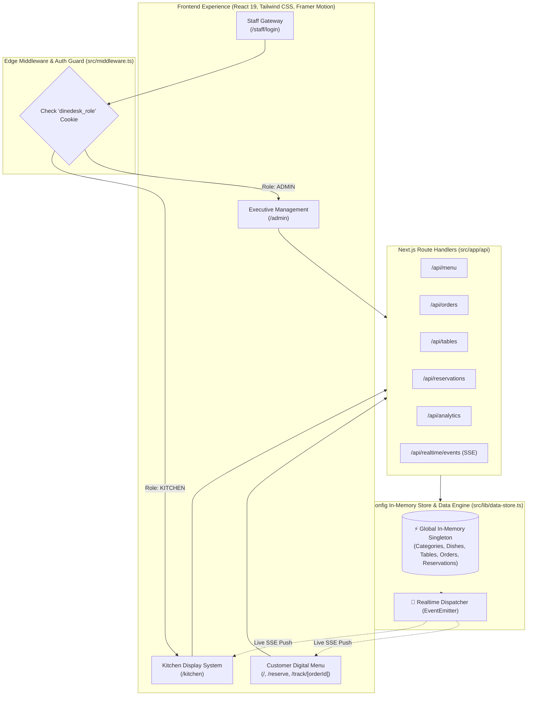

# DineDesk — Enterprise Restaurant Operating Platform

[](https://nextjs.org/)
[](https://react.dev/)
[](https://www.typescriptlang.org/)
[](https://tailwindcss.com/)
[](https://vercel.com/)
[](https://codsoft.in/)

**DineDesk** is an enterprise-grade digital dining, kitchen fulfillment, and table management platform built for modern restaurants. Designed to commercial hospitality standards (inspired by Swiggy, Zomato, Toast POS, and OpenTable), DineDesk unifies customer guest ordering, kitchen line management, and restaurant operations into a single cohesive, high-performance web platform.

---

## 🌟 Executive Summary & Key Highlights

- **Zero-Config Cloud Deployment**: Runs 100% database-free out-of-the-box on Vercel with an active, zero-latency in-memory data store. No PostgreSQL setup or environment variables required to deploy.
- **Strict Role-Based Portal Segregation**: Customer guest dining (`/`), Kitchen Display System (`/kitchen`), and Restaurant Operations (`/admin`) are physically isolated route groups protected by Next.js Edge Middleware.
- **Toast POS-Grade Kitchen Display System (KDS)**: Real-time ticket management with sound chimes, SLA cook timers, urgent order flash states, and Server-Sent Events (SSE) synchronization.
- **Interactive Table Reservation Engine**: Interactive floor plan (Window Bay, Main Dining, Patio, VIP Booth) with atomic double-booking prevention and guest capacity validation.
- **Live Order Tracking**: Dynamic step progression (`PENDING` ➔ `PREPARING` ➔ `READY` ➔ `SERVED`), estimated arrival timers, and direct customer dispatch receipts.
- **Enterprise Security & Compliance**: Strict HTTP security headers (HSTS, CSP-ready, nosniff, SAMEORIGIN), non-intrusive cookie consent banner, full legal compliance suite (`/terms`, `/privacy`, `/cookies`), and custom global error boundaries.

---

## 🏗️ Architecture & Core Portals



---

## 🚀 The Three Dedicated Portals

### 1. Customer Dining Portal (Public / Diner Session)
- **Menu & Filtering (`/`)**: Authentic multi-category catalog (Biryanis, Handcrafted Sourdough Pizzas, Smash Burgers, Amritsari Parathas, Lebanese Shawarmas, Thick Milkshakes, and Desserts) with instant search and dietary badges (Vegetarian green dot, Non-Vegetarian brown triangle, Vegan, Gluten-Free).
- **Cart & Checkout Drawer**: Slide-over cart with dynamic order type selection (Dine-in with Table selection, Takeaway, Delivery), customizable order instructions, tip selection, and real-time total breakdown.
- **Table Booking (`/reserve`)**: Interactive seating layout across 8 tables with guest count constraints, date/time slot selection, and immediate booking confirmation.
- **Live Order Tracker (`/track/[orderId]`)**: Real-time ticker displaying preparation countdown, kitchen line status, itemized receipt, and confetti celebration on delivery.

### 2. Kitchen Display System (KDS — Staff Portal)
- **Toast POS-Grade Interface (`/kitchen`)**: High-contrast, dark-mode terminal engineered for commercial kitchen wall displays.
- **Status Progression**: One-click ticket transitions: `PENDING` ➔ `PREPARING` ➔ `READY` ➔ `SERVED` (or `CANCELLED`).
- **Real-Time Synchronized Chimes**: Visual notification pulse and audio chime when a customer places a new ticket.
- **SLA Cook Timers**: Dynamic elapsed minutes indicators with automatic urgency badges for orders exceeding kitchen prep target times.

### 3. Executive Management Console (`/admin`)
- **Operations Dashboard (`/admin`)**: High-level restaurant KPIs: Total Revenue (₹), Total Orders, Active Kitchen Tickets, and Table Occupancy Rates.
- **Floor Plan Management**: Real-time visual table map showing current table status (`AVAILABLE`, `OCCUPIED`, `RESERVED`) with manual status overrides.
- **Menu Inventory Control**: Toggle menu items in-stock or sold-out in real-time, or edit item pricing directly.
- **Reservation Schedule**: Centralized view of guest bookings and guest arrival check-ins.

---

## 🔒 Role-Based Access Control (RBAC) Matrix

| Portal | Route | Permitted Roles | Unauthorized Action |
| :--- | :--- | :--- | :--- |
| **Customer Experience** | `/`, `/reserve`, `/track/*` | Public / All | Publicly accessible (Zero staff buttons shown) |
| **Kitchen Display** | `/kitchen`, `/kds` | `KITCHEN`, `ADMIN` | Redirects to `/staff/login?from=/kitchen&unauthorized=true` |
| **Admin Operations** | `/admin` | `ADMIN` Only | Redirects to `/staff/login?from=/admin&unauthorized=true` |
| **Staff Gateway** | `/staff/login` | Public Gateway | Includes 1-Click demo authentication buttons for evaluations |

---

## ⚡ Zero-Config Vercel Deployment (Plug & Play)

DineDesk is pre-configured to deploy on **Vercel** with **zero setup** and **zero database provisioning**:

1. **Push or Fork** this repository to your GitHub account.
2. In the [Vercel Dashboard](https://vercel.com/new), select **"Import Git Repository"** and select `CODSOFT_2`.
3. **Leave all environment variables empty** (none are required).
4. Click **Deploy**. Vercel will build and launch the platform in ~30 seconds.

> **How it works**: The platform utilizes an optimized, in-memory data store singleton (`src/lib/data-store.ts`) that initializes authentic Indian food catalog data, restaurant floor tables, and mock orders. State mutations (placing orders, booking tables, moving KDS tickets) persist across warm serverless requests without requiring an external database.

*(Optional)* If you wish to connect an external PostgreSQL database in the future, simply define `DATABASE_URL` in your environment settings and run `npm run prisma:push`.

---

## 💻 Local Development Quickstart

### Prerequisites
- Node.js 18.x or 20.x
- npm or pnpm

### Installation
```bash
# 1. Clone the repository
git clone https://github.com/ChaitraAkashGuthula/CODSOFT_2.git
cd CODSOFT_2

# 2. Install dependencies (triggers prisma generate automatically)
npm install

# 3. Launch local development server
npm run dev
```

Open [http://localhost:3000](http://localhost:3000) in your browser:
- **Customer Menu**: [http://localhost:3000/](http://localhost:3000/)
- **Book a Table**: [http://localhost:3000/reserve](http://localhost:3000/reserve)
- **Live Order Tracker**: [http://localhost:3000/track/ORD-1001](http://localhost:3000/track/ORD-1001)
- **Staff Gateway**: [http://localhost:3000/staff/login](http://localhost:3000/staff/login)
  - *Click `[Login as Kitchen Staff]` to enter `/kitchen`*
  - *Click `[Login as Restaurant Admin]` to enter `/admin`*

### Production Build & Verification
```bash
# Build optimized static and dynamic routes
npm run build

# Run local production server
npm run start
```

---

## 📡 API Reference & Endpoints

| Endpoint | Method | Purpose |
| :--- | :--- | :--- |
| `/api/menu` | `GET`, `POST` | Retrieve all categories and dishes; create new menu item |
| `/api/menu/[id]` | `GET`, `PATCH`, `DELETE` | Fetch, update stock/price, or remove a menu item |
| `/api/orders` | `GET`, `POST` | Fetch order history; place new order with tax/tip computation |
| `/api/orders/[id]` | `GET`, `PATCH` | Fetch order details by ID or `orderNumber`; update status |
| `/api/tables` | `GET`, `PATCH` | Fetch floor plan and occupancy; override table status |
| `/api/reservations` | `GET`, `POST` | List reservations; book new table with collision checks |
| `/api/reservations/[id]` | `PATCH` | Update reservation status (`SEATED`, `COMPLETED`, `CANCELLED`) |
| `/api/analytics` | `GET` | Calculate total revenue, order counts, and top-selling dishes |
| `/api/realtime/events` | `GET` | Server-Sent Events (SSE) live push stream for kitchen and orders |
| `/api/auth/staff-login` | `POST` | Issue staff session cookies (`dinedesk_role`) |
| `/api/auth/logout` | `POST` | Clear staff session cookies and redirect to login |

---

## 🛡️ Security, Privacy & Performance

- **Sanitized Secrets**: No database passwords, personal access tokens, or sensitive API keys are committed or exposed.
- **HTTP Security Headers**: Enforced across all routes via `next.config.ts`:
  - `Strict-Transport-Security: max-age=63072000; includeSubDomains; preload`
  - `X-Frame-Options: SAMEORIGIN`
  - `X-Content-Type-Options: nosniff`
  - `Referrer-Policy: strict-origin-when-cross-origin`
  - `Permissions-Policy: camera=(), microphone=(), geolocation=(), browsing-topics=()`
- **Cookie Consent Banner (`src/components/CookieConsent.tsx`)**: Fixed bottom-right non-intrusive compliance card reading/writing to `localStorage` (`app_cookie_consent_v1`).
- **Dedicated Legal Pages**: Static pages at `/terms`, `/privacy`, and `/cookies` with full metadata and clean navigation.
- **Global Error Boundary (`src/app/global-error.tsx`)**: Catches unhandled exceptions with full recovery UI and back-to-menu navigation.

---

## 👨‍💻 Project Information

- **Project**: CodSoft Web Development Task 2 — Restaurant Ordering Platform (DineDesk)
- **Repository**: [https://github.com/ChaitraAkashGuthula/CODSOFT_2](https://github.com/ChaitraAkashGuthula/CODSOFT_2)
- **Author**: Akash Guthula
- **License**: MIT
